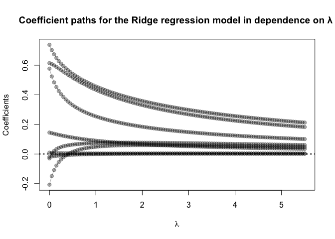
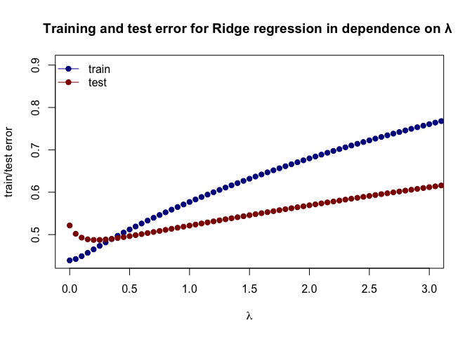

Correlation among variables
---------------------------

    library('ElemStatLearn')  ## for 'prostate'
    library('dplyr')          ## for 'select', 'filter', and others

    ## 
    ## Attaching package: 'dplyr'

    ## The following objects are masked from 'package:stats':
    ## 
    ##     filter, lag

    ## The following objects are masked from 'package:base':
    ## 
    ##     intersect, setdiff, setequal, union

    library('magrittr')       ## for '%<>%' operator
    library('glmnet')         ## for 'glmnet'

    ## Loading required package: Matrix

    ## Loaded glmnet 3.0-2

    ###  Linear regression examples ###
    data('prostate')
    cor(prostate %>% select(-train,-lpsa))

    ##            lcavol   lweight       age         lbph         svi
    ## lcavol  1.0000000 0.2805214 0.2249999  0.027349703  0.53884500
    ## lweight 0.2805214 1.0000000 0.3479691  0.442264395  0.15538491
    ## age     0.2249999 0.3479691 1.0000000  0.350185896  0.11765804
    ## lbph    0.0273497 0.4422644 0.3501859  1.000000000 -0.08584324
    ## svi     0.5388450 0.1553849 0.1176580 -0.085843238  1.00000000
    ## lcp     0.6753105 0.1645371 0.1276678 -0.006999431  0.67311118
    ## gleason 0.4324171 0.0568821 0.2688916  0.077820447  0.32041222
    ## pgg45   0.4336522 0.1073538 0.2761124  0.078460018  0.45764762
    ##                  lcp    gleason      pgg45
    ## lcavol   0.675310484 0.43241706 0.43365225
    ## lweight  0.164537146 0.05688210 0.10735379
    ## age      0.127667752 0.26889160 0.27611245
    ## lbph    -0.006999431 0.07782045 0.07846002
    ## svi      0.673111185 0.32041222 0.45764762
    ## lcp      1.000000000 0.51483006 0.63152825
    ## gleason  0.514830063 1.00000000 0.75190451
    ## pgg45    0.631528246 0.75190451 1.00000000

Fit linear model and calculate test error
-----------------------------------------

    ## split prostate into testing and training subsets
    prostate_train <- prostate %>%
      filter(train == TRUE) %>% 
      select(-train)

    prostate_test <- prostate %>%
      filter(train == FALSE) %>% 
      select(-train)

    ## predict lcavol consider all other predictors
    ## lm fits using L2 loss
    fit <- lm(lpsa ~ ., data=prostate_train)

    ## functions to compute testing/training error w/lm
    L2_loss <- function(y, yhat)
      (y-yhat)^2
    error_lm <- function(dat, fit, loss=L2_loss) mean(loss(dat$lpsa, predict(fit, newdata=dat)))

    ## testing error
    error_lm(prostate_test, fit)

    ## [1] 0.521274

Train the Ridge regression model and create a path diagram
----------------------------------------------------------

    ## use glmnet to fit ridge
    ## glmnet fits using penalized L2 loss
    ## first create an input matrix and output vector
    form  <- lpsa  ~ 0 + lweight + age + lbph + lcp + pgg45 + lcavol+ svi + gleason
    x_inp <- model.matrix(form, data=prostate_train)
    y_out <- prostate_train$lpsa
    fit <- glmnet(x=x_inp, y=y_out,alpha = 0, lambda=seq(5.5, 0, -0.05))

    ## plot path diagram
    plot(x=range(fit$lambda),
         y=range(as.matrix(fit$beta)),
         type='n',
         xlab=expression(lambda),
         ylab='Coefficients')
    for(i in 1:nrow(fit$beta)) {
      points(x=fit$lambda, y=fit$beta[i,], pch=19,col='#00000055')
      lines(x=fit$lambda, y=fit$beta[i,], col='#00000055')
    }
    abline(h=0, lty=3, lwd=2)
    title('Coefficient paths for the Ridge regression model in dependence on λ ')

Training and test error associated with ridge regression as a function of lambda
--------------------------------------------------------------------------------

    ## functions to compute testing/training error with glmnet
    error <- function(dat, fit, lam, form, loss=L2_loss) {
      x_inp <- model.matrix(form, data=dat)
      y_out <- dat$lpsa
      y_hat <- predict(fit, newx=x_inp, s=lam)  ## see predict.elnet
      mean(loss(y_out, y_hat))
    }

    ## compute training and testing errors as function of lambda
    err_train_1 <- sapply(fit$lambda, function(lam) 
      error(prostate_train, fit, lam, form))

    err_test_1 <- sapply(fit$lambda, function(lam) 
      error(prostate_test, fit, lam, form))

    ## plot test/train error
    plot(x=range(0,3),
         y=range(c(err_train_1, err_test_1)),
         type='n',
         xlab=expression(lambda),
         ylab='train/test error')
    points(fit$lambda, err_train_1, pch=19, type='b', col='darkblue')
    points(fit$lambda, err_test_1, pch=19, type='b', col='darkred')
    legend('topleft', c('train','test'), lty=1, pch=19,
           col=c('darkblue','darkred'), bty='n')
    title('Training and test error for Ridge regression in dependence on λ ')

